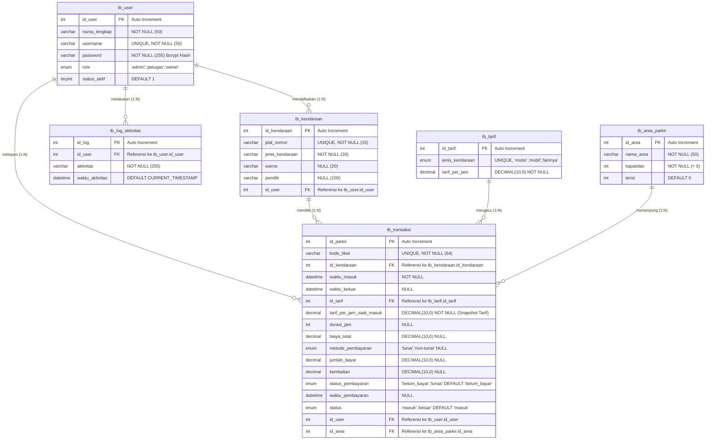

# ENTITY RELATIONSHIP DIAGRAM (ERD)
## SISTEM INFORMASI PARKIR BERBASIS WEB (6 TABEL UTAMA)

Dokumen ini memuat diagram relasi antar tabel (ERD) beserta spesifikasi Primary Key (PK), Foreign Key (FK), dan kardinalitas relasi untuk basis data `parkir`.

### Keterangan Relasi & Kardinalitas:
1. **`tb_user` &rarr; `tb_kendaraan` (One to Many / 1:N)**: Satu pengguna (petugas/admin) dapat mendaftarkan banyak kendaraan ke dalam sistem.
2. **`tb_user` &rarr; `tb_transaksi` (One to Many / 1:N)**: Satu petugas dapat menangani banyak transaksi kendaraan masuk dan keluar.
3. **`tb_user` &rarr; `tb_log_aktivitas` (One to Many / 1:N)**: Setiap pengguna tercatat melakukan banyak log aktivitas.
4. **`tb_kendaraan` &rarr; `tb_transaksi` (One to Many / 1:N)**: Satu kendaraan dapat memiliki banyak riwayat transaksi parkir sepanjang waktu.
5. **`tb_tarif` &rarr; `tb_transaksi` (One to Many / 1:N)**: Satu tarif kendaraan menjadi referensi untuk banyak transaksi.
6. **`tb_area_parkir` &rarr; `tb_transaksi` (One to Many / 1:N)**: Satu area parkir menampung banyak transaksi parkir.
