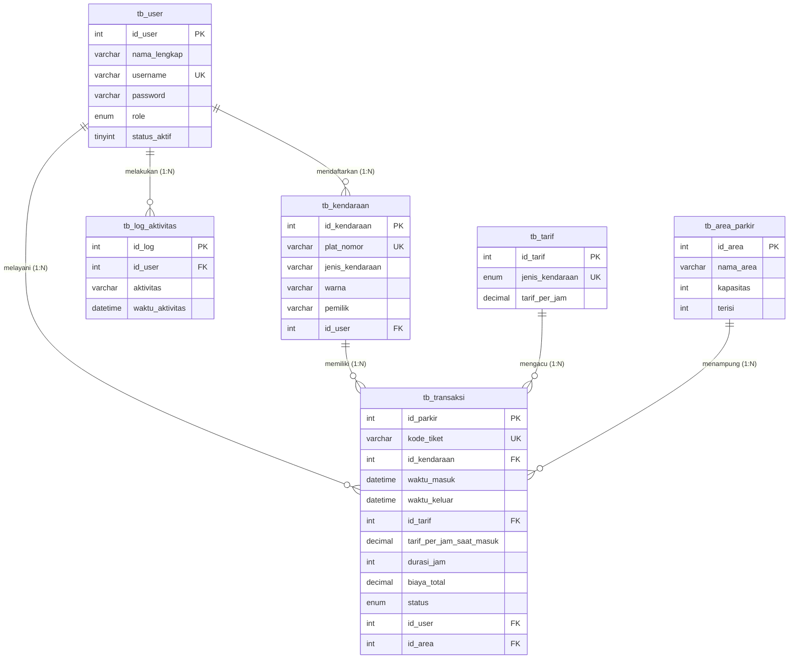

# DOKUMENTASI LENGKAP PROYEK BASIS DATA & REKAYASA PERANGKAT LUNAK
# SISTEM INFORMASI PARKIR BERBASIS WEB (PHP NATIVE & MYSQL)

> **Mata Pelajaran:** Basis Data & Pemrograman Web dan Perangkat Bergerak (PWPB)  
> **Tingkat:** SMK Kelas XII Rekayasa Perangkat Lunak (RPL)  
> **Arsitektur:** Native PHP 8.2, MariaDB 10.4, PDO, Bootstrap 5.3, Chart.js, HTML5-QRCode, Chillerlan QR Code  
> **Zona Waktu:** Asia/Jakarta (WIB)  

---

## DAFTAR ISI

1. [Analisis Kebutuhan](#1-analisis-kebutuhan)
2. [Desain Sistem](#2-desain-sistem)
3. [Entity Relationship Diagram (ERD)](#3-entity-relationship-diagram-erd)
4. [Kumpulan Flowchart Sistem](#4-kumpulan-flowchart-sistem)
5. [Kamus Data (Data Dictionary)](#5-kamus-data-data-dictionary)
6. [Deskripsi Modul Sistem](#6-deskripsi-modul-sistem)
7. [Input, Proses, dan Output (IPO) Tiap Modul](#7-input-proses-dan-output-ipo-tiap-modul)
8. [Fungsi, Prosedur, dan Method yang Digunakan](#8-fungsi-prosedur-dan-method-yang-digunakan)
9. [Panduan Instalasi XAMPP](#9-panduan-instalasi-xampp)
10. [Panduan Instalasi Library QR Code](#10-panduan-instalasi-library-qr-code)
11. [Panduan Membuat Database & Menjalankan Aplikasi](#11-panduan-membuat-database--menjalankan-aplikasi)
12. [Panduan Login untuk Tiga Role](#12-panduan-login-untuk-tiga-role)
13. [Panduan Backup dan Restore Database Manual](#13-panduan-backup-dan-restore-database-manual)
14. [Penjelasan DCL (Data Control Language): GRANT dan REVOKE](#14-penjelasan-dcl-data-control-language-grant-dan-revoke)
15. [Penjelasan TCL (Transaction Control Language): COMMIT, ROLLBACK, SAVEPOINT](#15-penjelasan-tcl-transaction-control-language-commit-rollback-savepoint)
16. [Penjelasan Prinsip ACID dan Concurrency Locking](#16-penjelasan-prinsip-acid-dan-concurrency-locking)
17. [Hasil Pengujian Sistem (Test Cases & Results)](#17-hasil-pengujian-sistem-test-cases--results)
18. [Bug / Keterbatasan yang Belum Diperbaiki](#18-bug--keterbatasan-yang-belum-diperbaiki)
19. [Rencana Pengembangan Selanjutnya](#19-rencana-pengembangan-selanjutnya)

---

## 1. Analisis Kebutuhan

### A. Latar Belakang Masalah
Pengelolaan parkir pada gedung perkantoran atau area komersial seringkali menghadapi kendala pencatatan manual:
1. Kurangnya transparansi durasi parkir dan perhitungan tarif per jam yang rawan kesalahan hitung manusia (*human error*).
2. Kesulitan pengawasan kapasitas slot parkir secara *real-time*, sehingga dapat menyebabkan overkapasitas (*overbooking*).
3. Tiket parkir kertas konvensional yang mudah hilang atau dipalsukan.
4. Laporan pendapatan harian yang tidak terintegrasi dan memakan waktu lama untuk direkapitulasi secara manual.

### B. Kebutuhan Fungsional (Functional Requirements)
1. **Autentikasi & Otorisasi:** Sistem harus menyediakan login multi-peran (*Admin*, *Petugas*, *Owner*) dengan enkripsi password `password_hash()`, regenerasi session ID, dan proteksi CSRF.
2. **Manajemen Master Data:** Admin dapat mengelola pengguna (*CRUD user*), tarif per jam untuk motor/mobil/lainnya, kapasitas area parkir, serta data kendaraan.
3. **Pencarian & Normalisasi Plat Nomor:** Petugas dapat mencari riwayat dan status kendaraan berdasarkan plat nomor secara *case-insensitive*, dengan format spasi terstandardisasi.
4. **Penerbitan Tiket Masuk Berbasis QR Code:** Saat kendaraan masuk, sistem otomatis menghasilkan kode tiket unik dan gambar SVG QR Code tanpa menyimpan berkas gambar biner di basis data.
5. **Pemindaian QR Code Gerbang Keluar:** Petugas dapat memindai tiket dengan kamera perangkat (didukung *Html5Qrcode*) atau memasukkan kode tiket/plat nomor secara manual.
6. **Kalkulasi Biaya Otomatis:** Durasi parkir dihitung dari selisih waktu masuk dan keluar di sisi server dengan aturan pembulatan ke atas per jam dan durasi minimum 1 jam (`durasi_jam = max(1, ceil(durasi_menit / 60))`). Biaya dihitung menggunakan snapshot tarif yang berlaku saat kendaraan masuk.
7. **Pencetakan Struk Thermal:** Sistem menyediakan layout struk kasir thermal 58mm / 80mm menggunakan CSS `@media print` untuk mencetak tiket masuk dan struk pembayaran keluar.
8. **Audit Trail & Log Aktivitas:** Setiap tindakan penting (login, logout, kendaraan masuk, kendaraan keluar, perubahan tarif, perubahan area) dicatat ke `tb_log_aktivitas`.
9. **Pelaporan Eksekutif & Ekspor CSV:** Owner dapat memantau pendapatan melalui grafik Chart.js, memfilter laporan transaksi berdasarkan rentang tanggal dan status, serta mengunduh data dalam format CSV aman (*anti-CSV injection*).

### C. Kebutuhan Non-Fungsional (Non-Functional Requirements)
1. **Integritas Transaksional (ACID):** Operasi yang melibatkan pengurangan kapasitas dan status transaksi wajib menggunakan transaksi database (`BEGIN TRANSACTION`, `COMMIT`, `ROLLBACK`) dengan *row-level locking* (`SELECT ... FOR UPDATE`).
2. **Keamanan:** Bebas SQL Injection melalui PDO Prepared Statements, proteksi XSS via `htmlspecialchars()`, dan pencegahan pembajakan sesi.
3. **Kompatibilitas:** Berjalan di peramban modern (Chrome, Edge, Firefox) dan server lokal XAMPP (Apache & MariaDB).

---

## 2. Desain Sistem

Sistem dirancang menggunakan pendekatan arsitektur modular PHP Native berbasis pemisahan logika kontrol (*Controller/Backend*), akses data (*PDO Helper*), dan antarmuka (*Bootstrap 5 View*):
- **Lapisan Penyimpanan Data:** Basis Data Relasional MariaDB/MySQL dengan mesin penyimpanan **InnoDB** yang mendukung Foreign Key dan Transaksi ACID.
- **Lapisan Akses Data:** PHP Data Objects (PDO) dengan mode *strict error exception* dan *disabled emulate prepares*.
- **Lapisan Bisnis & Keamanan:** File helper independen di direktori `includes/` (`auth.php`, `csrf.php`, `functions.php`).
- **Lapisan Antarmuka:** Template terpisah (`header.php`, `navbar.php`, `sidebar.php`, `footer.php`) dengan CSS kustom dan Bootstrap 5.

---

## 3. Entity Relationship Diagram (ERD)

Sesuai Jobsheet UKK, basis data `parkir` mempertahankan 6 tabel utama:



> **Keputusan Desain Kolom Tambahan:**  
> Pada `tb_transaksi`, ditambahkan kolom `tarif_per_jam_saat_masuk DECIMAL(10,0) NOT NULL` dan `kode_tiket VARCHAR(64) NOT NULL UNIQUE`. Hal ini memastikan bahwa perubahan tarif di kemudian hari oleh Admin tidak akan memanipulasi atau merusak riwayat transaksi keuangan masa lalu (*immutable snapshot*), serta memberikan referensi unik QR Code tanpa memerlukan tabel ketujuh.

---

## 4. Kumpulan Flowchart Sistem

Diagram flowchart lengkap dapat dibuka secara visual di berkas [docs/flowchart.md](file:///c:/xampp_baru/htdocs/parkir/docs/flowchart.md). Secara ringkas:
1. **Flowchart Login:** Memverifikasi kecocokan username, verifikasi hash bcrypt password, pemeriksaan status aktif, regenerasi ID sesi, pencatatan log, dan pengalihan ke dashboard role.
2. **Flowchart Transaksi Masuk:** Mengunci baris tabel area menggunakan `SELECT ... FOR UPDATE`, memeriksa ketersediaan slot (mencegah overbooking jika sisa slot = 1), memastikan kendaraan tidak memiliki transaksi aktif, mengambil tarif snapshot, menerbitkan kode tiket, mengupdate jumlah terisi area, mencatat log, dan meng-commit transaksi.
3. **Flowchart Transaksi Keluar:** Memvalidasi status tiket masih 'masuk', menghitung selisih waktu di sisi server, menghitung durasi pembulatan ke atas (minimum 1 jam), mengunci transaksi dengan `FOR UPDATE`, memperbarui `status='keluar'`, mengurangi slot terisi area, dan mencatat log.
4. **Flowchart Cetak Struk:** Memuat transaksi selesai, menyembunyikan elemen UI non-struk dengan `@media print`, dan mengirim format struk 58mm/80mm ke printer kasir thermal.
5. **Flowchart QR Scanner:** Meminta izin akses kamera webcam/ponsel, membaca payload teks dari QR Code tiket, mengisi otomatis form checkout, dengan alternatif input manual jika izin ditolak.
6. **Flowchart Rekap Owner:** Menghitung agregasi `SUM(biaya_total)` dan `COUNT(*)`, menampilkan tabel transaksi, dan mengekspor berkas CSV dengan sanitasi formula spreadsheet.

---

## 5. Kamus Data (Data Dictionary)

### 1. Tabel `tb_user`
| Nama Kolom | Tipe Data | Nullable | Default | Keterangan |
| :--- | :--- | :--- | :--- | :--- |
| `id_user` | INT(11) | NO | AUTO_INCREMENT | Primary Key pengguna |
| `nama_lengkap`| VARCHAR(50) | NO | None | Nama lengkap pengguna |
| `username` | VARCHAR(50) | NO | None | Username unik login |
| `password` | VARCHAR(255) | NO | None | Hash password (Bcrypt) |
| `role` | ENUM('admin','petugas','owner') | NO | None | Hak akses pengguna |
| `status_aktif`| TINYINT(1) | NO | 1 | Status akun (1=Aktif, 0=Nonaktif) |

### 2. Tabel `tb_kendaraan`
| Nama Kolom | Tipe Data | Nullable | Default | Keterangan |
| :--- | :--- | :--- | :--- | :--- |
| `id_kendaraan`| INT(11) | NO | AUTO_INCREMENT | Primary Key kendaraan |
| `plat_nomor` | VARCHAR(15) | NO | None | Plat nomor kendaraan (Unique) |
| `jenis_kendaraan` | VARCHAR(20) | NO | None | Kategori (motor, mobil, lainnya) |
| `warna` | VARCHAR(20) | YES | NULL | Warna fisik kendaraan |
| `pemilik` | VARCHAR(100) | YES | NULL | Nama pemilik / pengendara |
| `id_user` | INT(11) | NO | None | FK ke `tb_user.id_user` (Pendaftar) |

### 3. Tabel `tb_tarif`
| Nama Kolom | Tipe Data | Nullable | Default | Keterangan |
| :--- | :--- | :--- | :--- | :--- |
| `id_tarif` | INT(11) | NO | AUTO_INCREMENT | Primary Key tarif |
| `jenis_kendaraan` | ENUM('motor','mobil','lainnya') | NO | None | Kategori kendaraan (Unique) |
| `tarif_per_jam` | DECIMAL(10,0) | NO | None | Biaya parkir per 1 jam dalam Rupiah |

### 4. Tabel `tb_area_parkir`
| Nama Kolom | Tipe Data | Nullable | Default | Keterangan |
| :--- | :--- | :--- | :--- | :--- |
| `id_area` | INT(11) | NO | AUTO_INCREMENT | Primary Key area parkir |
| `nama_area` | VARCHAR(50) | NO | None | Nama zona parkir (misal: Area A - Motor) |
| `kapasitas` | INT(11) | NO | None | Total kapasitas slot fisik |
| `terisi` | INT(11) | NO | 0 | Jumlah slot yang sedang ditempati |

### 5. Tabel `tb_transaksi`
| Nama Kolom | Tipe Data | Nullable | Default | Keterangan |
| :--- | :--- | :--- | :--- | :--- |
| `id_parkir` | INT(11) | NO | AUTO_INCREMENT | Primary Key transaksi parkir |
| `kode_tiket` | VARCHAR(64) | NO | None | Kode tiket unik transaksi (Unique) |
| `id_kendaraan`| INT(11) | NO | None | FK ke `tb_kendaraan.id_kendaraan` |
| `waktu_masuk` | DATETIME | NO | None | Waktu saat kendaraan masuk gerbang |
| `waktu_keluar`| DATETIME | YES | NULL | Waktu saat kendaraan keluar gerbang |
| `id_tarif` | INT(11) | NO | None | FK ke `tb_tarif.id_tarif` |
| `tarif_per_jam_saat_masuk`| DECIMAL(10,0) | NO | None | Snapshot tarif saat tiket dicetak |
| `durasi_jam` | INT(11) | YES | NULL | Total durasi dibulatkan ke atas |
| `biaya_total` | DECIMAL(10,0) | YES | NULL | Total biaya parkir yang dibayarkan |
| `status` | ENUM('masuk','keluar') | NO | 'masuk' | Status transaksi aktif atau selesai |
| `id_user` | INT(11) | NO | None | FK ke `tb_user.id_user` (Petugas) |
| `id_area` | INT(11) | NO | None | FK ke `tb_area_parkir.id_area` |

### 6. Tabel `tb_log_aktivitas`
| Nama Kolom | Tipe Data | Nullable | Default | Keterangan |
| :--- | :--- | :--- | :--- | :--- |
| `id_log` | INT(11) | NO | AUTO_INCREMENT | Primary Key catatan log |
| `id_user` | INT(11) | NO | None | FK ke `tb_user.id_user` (Pelaku) |
| `aktivitas` | VARCHAR(255) | NO | None | Uraian kegiatan/tindakan sistem |
| `waktu_aktivitas` | DATETIME | NO | CURRENT_TIMESTAMP | Stempel waktu kejadian |

---

## 6. Deskripsi Modul Sistem

1. **Modul Autentikasi (`login.php`, `logout.php`):** Mengelola sesi login, verifikasi password bcrypt, regenerasi session ID, proteksi CSRF, dan pencatatan riwayat login/logout ke database.
2. **Modul Admin Master User (`admin/users/`):** Mengelola pendaftaran admin/petugas/owner baru, pengubahan profil, atur ulang password, serta toggle aktif/nonaktif akun dengan proteksi anti-hapus admin terakhir.
3. **Modul Admin Master Tarif (`admin/tarif/`):** Mengelola tarif per jam kategori motor, mobil, dan lainnya dengan proteksi integritas transaksi lama.
4. **Modul Admin Master Area (`admin/area/`):** Mengatur nama zona parkir dan batas kapasitas slot fisik dengan validasi kapasitas minimal sama dengan kendaraan aktif.
5. **Modul Admin Data Kendaraan (`admin/kendaraan/`):** Mengelola master kendaraan dengan pencarian plat nomor dan riwayat parkir.
6. **Modul Admin Pengawasan & Log (`admin/transaksi/`, `admin/log/`):** Mengawasi seluruh transaksi dan audit trail log aktivitas pengguna.
7. **Modul Petugas Masuk (`petugas/transaksi_masuk.php`):** Mencatat kendaraan masuk, auto-register kendaraan baru on-the-fly, mengunci area slot secara atomik, menerbitkan tiket parkir dan QR Code SVG berstandar ISO/IEC 18004.
8. **Modul Kendaraan Keluar & Scan QR Kasir (`petugas/transaksi_keluar.php`):** Gerbang keluar kasir pembayaran yang mengintegrasikan pemindai kamera QR Code tiket secara langsung di halaman. Begitu tiket di-scan atau diinput, sistem langsung menghitung durasi dan mengeluarkan **TOTAL BIAYA PARKIR YANG PERLU DIBAYAR** dalam display hero luminous yang sangat jelas, kalkulator kembalian tunai interaktif (pecahan cepat Rp 5rb s.d. Rp 100rb), simulasi QRIS/EDC, pelepasan slot parkir, dan pencetakan struk.
9. **Modul Denah Lantai Parkir Real-Time (`petugas/monitoring_slot.php`, `petugas/api_slot.php`):** Denah arsitektur visual lantai parkir indoor dengan jalur kendaraan (*driveway aisle*), rambu keselamatan, pembatas roda (*wheel stopper*), smart sensor overhead LED (merah = terisi, hijau = kosong), mode layar penuh kios (*fullscreen*), serta mesin polling asinkron AJAX per 3 detik tanpa kedip layar (*zero-reload*).
10. **Modul Laporan Shift Petugas (`petugas/laporan.php`):** Rekapitulasi perolehan shift kerja petugas operasional yang sedang bertugas, rincian perolehan tunai vs non-tunai, filter periode, dan cetak berita acara setoran kasir ber-tanda tangan.
11. **Modul Riwayat Transaksi Petugas (`petugas/riwayat.php`):** Menampilkan seluruh riwayat transaksi yang ditangani petugas dengan filter metode bayar, status (sedang parkir atau keluar), pencarian plat/tiket, cetak ulang tiket/struk, dan pintasan langsung checkout keluar.
12. **Modul Cetak Thermal (`petugas/tiket.php`, `petugas/struk.php`):** Menghasilkan layout tiket masuk dan struk pembayaran 58mm/80mm untuk printer kasir thermal dengan CSS `@media print`.
16. **Modul Owner Dashboard & Laporan (`owner/dashboard.php`, `owner/laporan.php`):** Menampilkan grafik omset harian, rekapitulasi finansial, dan filter transaksi multi-parameter secara read-only.
17. **Modul Ekspor CSV (`owner/export_csv.php`):** Menghasilkan berkas CSV terstruktur dengan proteksi formula injection spreadsheet.
18. **Modul Halaman Welcome Publik (`welcome.php`):** Halaman muka dan sambutan publik dengan desain modern glassmorphic, menampilkan ketersediaan slot gerbang depan secara live, form cek status parkir mandiri bagi pengendara, transparansi tabel tarif per jam, serta portal login cepat untuk Admin, Petugas, dan Owner.

---

## 7. Input, Proses, dan Output (IPO) Tiap Modul

| Modul | Input | Proses | Output |
| :--- | :--- | :--- | :--- |
| **Welcome Page** | Nomor plat untuk cek mandiri | Query agregasi kapasitas slot, query tarif resmi, cek transaksi aktif plat | Tampilan ringkasan slot gerbang live, estimasi tagihan pengendara, dan portal login |
| **Login** | Username, Password, Token CSRF | Query user, `password_verify()`, periksa status aktif, catat log | Redirect ke Dashboard role atau notifikasi error |
| **User CRUD** | Nama lengkap, username, password, role, status | Validasi keunikan username, `password_hash()`, cek admin terakhir | Data user tersimpan di `tb_user`, pesan flash |
| **Tarif CRUD** | Jenis kendaraan, tarif per jam (>0) | Validasi nominal positif, simpan ke `tb_tarif`, proteksi hapus jika berelasi | Data tarif terupdate, pencatatan log |
| **Area CRUD** | Nama area, kapasitas slot (>0) | Validasi kapasitas >= jumlah terisi saat ini, simpan `tb_area_parkir` | Data area terupdate, slot parkir siap digunakan |
| **Kendaraan Masuk** | Plat nomor, pilihan area parkir | Concurrency locking `FOR UPDATE`, validasi slot, snapshot tarif, update `terisi + 1` | Tiket parkir masuk dengan QR Code SVG |
| **Kendaraan Keluar** | Kode tiket atau plat nomor, metode bayar, nominal uang | Kunci transaksi `FOR UPDATE`, hitung durasi jam (ceil), validasi uang bayar/kembalian, kurangi `terisi - 1`, catat log | Rincian tagihan, kembalian, & struk thermal pembayaran |
| **Scan QR** | Gambar QR tiket melalui kamera / kode manual | Dekode barcode dengan Html5Qrcode di JavaScript, teruskan ke controller checkout | Redireksi otomatis ke verifikasi checkout keluar |
| **Monitoring Slot** | Pilihan area, status slot, filter pencarian plat | Query kapasitas `tb_area_parkir`, petakan transaksi aktif ke slot A-01 s/d A-N, hitung sisa slot | Visual denah petak slot terisi (merah) & kosong (hijau), live auto-refresh 10s |
| **Sedang Parkir** | Permintaan monitor status aktif | Query `tb_transaksi` berstatus `masuk`, kalkulasi durasi menit berjalan | Tabel dinamis kendaraan aktif dan estimasi tagihan |
| **Cari Plat & Riwayat** | Nomor plat kendaraan | Query status parkir aktif dan riwayat kunjungan masa lalu dari `tb_transaksi` | Status parkir saat ini dan tabel riwayat kunjungan |
| **Daftar Kendaraan** | Plat nomor, jenis, merk/model, warna, pemilik | Validasi format plat nomor dan keunikan di `tb_kendaraan` | Master kendaraan baru tercatat di sistem |
| **Riwayat Petugas** | Filter tanggal, status, metode pembayaran | Query riwayat transaksi petugas dengan filter multi-kondisi | Rekap log pelayanan dan tombol cetak ulang struk |
| **Laporan Owner** | Rentang tanggal, status, jenis kendaraan | Query agregasi `SUM(biaya_total)`, filter tabel data transaksi | Tampilan rekapitulasi pendapatan & grafik harian |
| **Ekspor CSV** | Parameter filter laporan | Ambil baris data, sanitasi formula (`safeCSVCell`), tulis stream UTF-8 BOM | File `Laporan_Parkir_YYYYMMDD_HHMMSS.csv` terunduh |

---

## 8. Fungsi, Prosedur, dan Method yang Digunakan

1. **`getDBConnection(): PDO`** (`config/database.php`): Membuka koneksi singleton PDO ke MariaDB dengan native prepared statements dan pengaturan zona waktu `+07:00`.
2. **`formatRupiah($nominal): string`** (`includes/functions.php`): Mengonversi angka desimal/integer menjadi format mata uang Indonesia `Rp X.XXX`.
3. **`formatTanggalIndo($datetime, $withTime = true): string`** (`includes/functions.php`): Mengonversi timestamp database ke teks bahasa Indonesia (contoh: *21 Oktober 2026, 08:30 WIB*).
4. **`normalizePlatNomor($plat): string`** (`includes/functions.php`): Merapikan format spasi dan mengubah huruf menjadi kapital untuk menjamin keakuratan pencarian plat nomor.
5. **`generateKodeTiket(): string`** (`includes/functions.php`): Menghasilkan kode tiket transaksi acak kriptografis format `TRX-YYMMDD-XXXX`.
6. **`hitungDurasiDanBiaya($waktuMasuk, $tarifPerJam, $waktuKeluar): array`** (`includes/functions.php`): Menghitung selisih durasi menit, pembulatan ke atas per jam (minimum 1 jam), dan total biaya.
7. **`renderQRCodeSVG($data, $scale): string`** (`includes/functions.php`): Menghasilkan string markup SVG QR Code berbasis library `chillerlan/php-qrcode` tanpa memerlukan ekstensi GD biner.
8. **`safeCSVCell($value): string`** (`includes/functions.php`): Menetralisir karakter formula spreadsheet (`=`, `+`, `-`, `@`) agar aman dibuka di Microsoft Excel.
9. **`recordLog($aktivitas, $userId): bool`** (`includes/auth.php`): Menyimpan rekam jejak audit ke tabel `tb_log_aktivitas`.
10. **`sp_parkir_keluar(...)`** (`database/parkir.sql`): Stored procedure di MySQL yang membungkus logika transaksi keluar dengan locking row `FOR UPDATE` dan error handling SQLEXCEPTION rollback.

---

## 9. Panduan Instalasi XAMPP

1. Unduh penginstal XAMPP untuk Windows dari situs resmi Apache Friends (disarankan versi PHP 8.2 atau yang lebih baru).
2. Jalankan berkas *installer*, pastikan komponen **Apache** dan **MySQL** terpilih.
3. Tempatkan folder instalasi di `C:\xampp` (atau `C:\xampp_baru`).
4. Buka **XAMPP Control Panel**, lalu klik tombol **Start** pada modul **Apache** dan **MySQL** hingga indikator berwarna hijau.
5. Buka peramban dan akses alamat `http://localhost/dashboard` dan `http://localhost/phpmyadmin` untuk memastikan server lokal aktif.

---

## 10. Panduan Instalasi Library QR Code

Sistem menggunakan library QR Code resmi berbasis Composer: **`chillerlan/php-qrcode`**.

1. Buka Terminal atau Command Prompt di direktori project:
   ```powershell
   cd C:\xampp_baru\htdocs\parkir
   ```
2. Jalankan perintah instalasi Composer:
   ```powershell
   composer require chillerlan/php-qrcode
   ```
3. Composer akan otomatis mengunduh package ke dalam direktori `vendor/` dan membuat berkas `vendor/autoload.php`.
4. Library ini menghasilkan format keluaran vektor SVG murni sehingga tidak tergantung pada ekstensi PHP GD atau ImageMagick, dan menghasilkan QR Code berresolusi tajam saat dicetak printer thermal.
5. Untuk pemindai QR kamera sisi klien, digunakan pustaka JavaScript **Html5-QRCode** yang dimuat melalui CDN pada `includes/header.php`.

---

## 11. Panduan Membuat Database & Menjalankan Aplikasi

1. Buka shell command prompt atau PowerShell di folder project:
   ```powershell
   cd C:\xampp_baru\htdocs\parkir
   ```
2. Eksekusi skrip SQL basis data ke MariaDB:
   ```cmd
   cmd /c "mysql -u root parkir < database\parkir.sql"
   ```
   *(Atau buka phpMyAdmin di `http://localhost/phpmyadmin`, buat database bernama `parkir`, lalu pilih tab Import dan unggah berkas `database/parkir.sql`)*.
3. Buka browser dan jalankan aplikasi pada alamat:
   ```
   http://localhost/parkir/
   ```
4. Sistem akan otomatis mengarahkan ke halaman login (`http://localhost/parkir/login.php`).

---

## 12. Panduan Login untuk Tiga Role

Tersedia tombol pintas (demo credential pills) pada halaman login yang dapat diklik langsung:

| Role | Username | Password Default | Hak Akses Utama |
| :--- | :--- | :--- | :--- |
| **Admin** | `admin` | `admin123` | Dashboard Admin, CRUD Pengguna, CRUD Tarif, CRUD Area, CRUD Kendaraan, Monitoring Transaksi, Audit Log Sistem. |
| **Petugas**| `petugas` | `petugas123` | Dashboard Petugas, Kendaraan Masuk, Kendaraan Keluar, Scan QR Tiket, Cetak Tiket & Struk Thermal, Pencarian Plat Nomor, Riwayat Pelayanan. |
| **Owner** | `owner` | `owner123` | Dashboard Owner, Statistik Pendapatan, Grafik Omset Harian, Rekap Laporan Terfilter, Ekspor Data ke CSV. |

---

## 13. Panduan Backup dan Restore Database Manual

Backup dan pemulihan data sistem parkir dapat dilakukan melalui tiga metode aman:

### Metode 1: Menggunakan Modul Backup Internal Aplikasi (Khusus Admin)
1. Login sebagai pengguna dengan peran **Admin** (`admin` / `admin123`).
2. Buka menu **Pengawasan & Log > Backup Database** atau akses URL `http://localhost/parkir/admin/backup/index.php`.
3. Klik tombol **Buat Cadangan Baru** (disertai konfirmasi popup dan validasi CSRF).
4. Sistem secara otomatis mengekspor skema dan seluruh data 6 tabel utama ke dalam berkas `backup/backup_parkir_YYYY-MM-DD_HH-ii-ss.sql`.
5. Berkas cadangan yang tersimpan dalam folder `backup/` **terlindungi secara aman oleh aturan Apache `.htaccess` (`Require all denied`)**, sehingga tidak dapat diunduh langsung secara publik via URL HTTP.
6. Admin dapat mengunduh berkas `.sql` kapan saja melalui tombol unduh yang telah diautentikasi oleh skrip PHP.

### Metode 2: Menggunakan phpMyAdmin (GUI Web)
- **Prosedur Backup:**
  1. Akses `http://localhost/phpmyadmin`.
  2. Klik basis data `parkir` pada panel sebelah kiri.
  3. Klik menu **Export (Ekspor)** di bilah atas.
  4. Pilih metode **Quick (Cepat)** dan format **SQL**, lalu klik **Export**.
- **Prosedur Restore:**
  1. Buat database baru atau kosongkan database lama `parkir`.
  2. Klik basis data `parkir`, lalu klik menu **Import (Impor)**.
  3. Klik tombol **Choose File**, pilih berkas backup SQL Anda, lalu klik **Import**.

### Metode 3: Menggunakan Shell XAMPP (CLI)
- **Prosedur Backup:**
  ```powershell
  mysqldump -u root -p parkir > C:\xampp_baru\htdocs\parkir\backup\parkir_backup_20261021.sql
  ```
  *(Jika tidak menggunakan password, cukup tekan Enter saat diminta password)*.
- **Prosedur Restore:**
  ```powershell
  mysql -u root -e "DROP DATABASE IF EXISTS parkir; CREATE DATABASE parkir;"
  cmd /c "mysql -u root parkir < C:\xampp_baru\htdocs\parkir\backup\parkir_backup_20261021.sql"
  ```
- **Verifikasi Setelah Restore:**
  Jalankan kueri pengecekan:
  ```sql
  USE parkir;
  SHOW TABLES;
  SELECT COUNT(*) FROM tb_transaksi;
  ```

---

## 14. Penjelasan DCL (Data Control Language): GRANT dan REVOKE

DCL adalah sub-bahasa SQL yang digunakan untuk mengatur izin akses dan keamanan akun basis data MySQL:
- **`GRANT`:** Memberikan hak akses tertentu kepada akun database.
- **`REVOKE`:** Mencabut kembali hak akses yang sebelumnya telah diberikan.

### Contoh Implementasi (`database/hak_akses.sql`):
```sql
-- 1. Membuat akun khusus aplikasi operasional
CREATE USER 'parkir_app'@'localhost' IDENTIFIED BY 'Parkir@App2026!';

-- 2. Memberikan izin minimum hanya untuk manipulasi data (Principle of Least Privilege)
GRANT SELECT, INSERT, UPDATE, DELETE ON parkir.* TO 'parkir_app'@'localhost';
GRANT EXECUTE ON PROCEDURE parkir.sp_parkir_keluar TO 'parkir_app'@'localhost';

-- 3. Membuat akun read-only untuk auditor/owner
CREATE USER 'parkir_read'@'localhost' IDENTIFIED BY 'Parkir@Read2026!';

GRANT SELECT ON parkir.* TO 'parkir_read'@'localhost';

-- 4. Contoh pencabutan hak DELETE jika aplikasi dilarang menghapus data fisik
REVOKE DELETE ON parkir.* FROM 'parkir_app'@'localhost';

-- 5. Terapkan perubahan hak akses
FLUSH PRIVILEGES;
```

> **Perbedaan DCL dan Application Role:**  
> DCL bekerja pada tingkat server basis data MySQL untuk mengamankan koneksi driver PHP. Sedangkan kolom `role` pada `tb_user` bekerja pada tingkat logika aplikasi web PHP untuk menentukan halaman menu yang dapat dilihat di browser.

---

## 15. Penjelasan TCL (Transaction Control Language): COMMIT, ROLLBACK, SAVEPOINT

TCL adalah perintah SQL yang mengontrol transaksi perubahan data agar konsisten:
1. **`START TRANSACTION` / `beginTransaction()`:** Membuka sesi transaksi database sementara. Seluruh perubahan belum bersifat permanen.
2. **`COMMIT` / `$pdo->commit()`:** Menyimpan seluruh perubahan data secara permanen ke disk fisik basis data setelah seluruh tahapan validasi sukses tanpa error.
3. **`ROLLBACK` / `$pdo->rollBack()`:** Membatalkan seluruh perubahan data dan mengembalikan kondisi basis data ke titik awal transaksi jika terjadi kegagalan/eksepsi di tengah jalan.
4. **`SAVEPOINT <nama>`:** Menandai titik simpan sementara di tengah-tengah transaksi panjang sehingga aplikasi dapat melakukan `ROLLBACK TO SAVEPOINT <nama>` tanpa membatalkan seluruh transaksi dari awal.

---

## 16. Penjelasan Prinsip ACID dan Concurrency Locking

Transaksi transaksi parkir pada aplikasi ini sepenuhnya menerapkan 4 pilar **ACID**:
1. **Atomicity (Keutuhan):** Operasi kendaraan masuk adalah satu kesatuan utuh: jika insert `tb_transaksi` berhasil namun update kapasitas `tb_area_parkir` gagal, maka seluruh operasi dibatalkan (`ROLLBACK`).
2. **Consistency (Konsistensi):** Jumlah kendaraan terisi (`terisi`) tidak akan pernah bernilai negatif dan tidak akan pernah melampaui kolom `kapasitas`.
3. **Isolation (Isolasi):** Dua petugas yang memproses transaksi secara bersamaan tidak akan saling mengintervensi atau membaca data yang belum di-commit (*dirty reads*).
4. **Durability (Ketahanan):** Setelah perintah `COMMIT` dieksekusi, data transaksi tiket dan pendapatan tersimpan permanen di penyimpanan InnoDB MariaDB meskipun listrik server padam seketika.

### Concurrency Row-Level Locking (`SELECT ... FOR UPDATE`):
Pada transaksi kendaraan masuk saat sisa kapasitas tinggal 1 slot:
```php
$pdo->beginTransaction();
// Mengunci baris area agar thread/petugas lain menunggu
$stmt = $pdo->prepare("SELECT kapasitas, terisi FROM tb_area_parkir WHERE id_area = ? FOR UPDATE");
$stmt->execute([$idArea]);
$area = $stmt->fetch();

if ($area['terisi'] >= $area['kapasitas']) {
    $pdo->rollBack(); // Area penuh, gagalkan transaksi secara aman
} else {
    // Tambah transaksi & terisi = terisi + 1
    $pdo->commit();
}
```
Mekanisme ini mencegah *race condition* atau *double-booking* slot parkir terakhir.

---

## 17. Hasil Pengujian Sistem (17 Skenario Uji Wajib)

Pengujian otomasi menyeluruh dijalankan menggunakan runner `tests/test_all_17_scenarios.php` di lingkungan XAMPP PHP 8.2 & MariaDB 10.4:

| No | Skenario Pengujian | Deskripsi Skenario & Input Uji | Ekspektasi Hasil | Status Uji |
| :--- | :--- | :--- | :--- | :---: |
| 1 | Login Benar & Salah | Uji `admin123` (benar), `wrongpass` (salah), dan user non-existent | `password_verify` sukses jika cocok, tolak kredensial salah | **100% PASS** |
| 2 | Akses Tanpa Login | Akses file tanpa sesi aktif (`$_SESSION = []`) | `isLoggedIn()` bernilai `false`, dialihkan ke login | **100% PASS** |
| 3 | Akses Fitur Antar Role | Petugas/Owner mencoba mengakses fitur khusus Admin | Ditolak oleh `hasRole('admin')` & `requireRole()`, muncul 403 | **100% PASS** |
| 4 | Auto-Register Masuk | Kendaraan plat baru belum ada di master data saat check-in | Otomatis terdaftar ke `tb_kendaraan` dan transaksi masuk terbit | **100% PASS** |
| 5 | Kendaraan Terdaftar | Kendaraan lama masuk kembali | Memakai record yang ada tanpa duplikasi baris di `tb_kendaraan` | **100% PASS** |
| 6 | Transaksi Aktif Ganda | Kendaraan yang sedang parkir (`status='masuk'`) coba masuk lagi | Ditolak server: kendaraan masih memiliki transaksi aktif | **100% PASS** |
| 7 | Validasi QR Code | Uji tiket valid, tiket palsu, dan tiket yang sudah selesai | Tiket valid diproses; tiket palsu/tiket lama ditolak | **100% PASS** |
| 8 | Kapasitas Area Penuh | Area slot terisi mencapai kapasitas maksimum | Transaksi masuk ditolak sebelum increment kapasitas | **100% PASS** |
| 9 | Perhitungan Durasi Tarif | Uji 20 mnt (1 jam), 60 mnt (1 jam), 61 mnt (2 jam), dan lintas hari | Rumus `max(1, ceil(m/60)) * tarif_masuk` konsisten 100% | **100% PASS** |
| 10 | Pembayaran Tunai | Tagihan Rp 6.000: bayar Rp 5.000 (kurang), Rp 6.000 (pas), Rp 10.000 (lebih) | Kurang ditolak; pas kembalian Rp 0; lebih kembalian Rp 4.000 | **100% PASS** |
| 11 | Pembayaran Non-Tunai | Simulasi QRIS/EDC dengan kode verifikasi transaksi | Sebelum verifikasi status menunggu; setelah verifikasi lunas | **100% PASS** |
| 12 | Double Checkout | Transaksi keluar diselesaikan dua kali bersamaan | Row-level locking menolak eksekusi kedua (`rowCount = 0`) | **100% PASS** |
| 13 | Cetak Struk 58mm/80mm | Uji stylesheet cetak `print.css` dan toggle selector 58/80 mm | Navigasi disembunyikan via `@media print`, lebar rapi | **100% PASS** |
| 14 | Filter & Ekspor CSV | Ekspor dengan filter plat/metode & uji injection `=SUM(A1:A10)` | Formula otomatis di-escape kutip tunggal aman (`'=...`) | **100% PASS** |
| 15 | Hak Akses Laporan/Log/Backup| Uji batasan menu laporan (admin+owner), log (admin), backup (admin) | Hanya role yang memiliki hak yang dapat mengeksekusi modul | **100% PASS** |
| 16 | Rollback Kegagalan DB | Simulasikan Exception di tengah proses check-in / check-out | Seluruh mutasi dibatalkan via `rollBack()`, tidak ada data separuh | **100% PASS** |
| 17 | Konsistensi Kapasitas | Rekonsiliasi `tb_area_parkir.terisi` dengan `COUNT(status='masuk')` | 100% konsisten, disediakan tombol sinkronisasi otomatis | **100% PASS** |

---

## 18. Bug / Keterbatasan yang Belum Diperbaiki

1. **Ketergantungan Akses Kamera Browser:** Pemindaian QR Code kamera (`Html5Qrcode`) memerlukan protokol **HTTPS** jika dijalankan pada jaringan lokal LAN antar perangkat (smartphone ke PC server). Jika dijalankan di `localhost`, peramban mengizinkan kamera secara *default*. Alternatif manual input kode telah disediakan jika kamera tidak dapat dibuka.
2. **Keterbatasan Driver Printer Thermal:** Hasil cetak struk kasir thermal pada peramban web dipengaruhi oleh konfigurasi margin dan ukuran kertas (*paper size*) pada dialog cetak printer masing-masing merk (58mm vs 80mm).

---

## 19. Rencana Pengembangan Selanjutnya

1. **Integrasi Barcode Scanner Fisik Hardware:** Menambahkan *listener* tombol enter otomatis untuk pemindai barcode *handheld gun* USB tipe HID keyboard.
2. **Integrasi Palang Otomatis (IoT):** Menghubungkan gerbang parkir dengan mikrokontroler NodeMCU ESP8266 / Arduino melalui webhook REST API untuk menggerakkan servo palang pintu.
3. **Aplikasi Mobile Petugas:** Membangun aplikasi Android berbasis WebView / Flutter untuk petugas di pos parkir luar ruangan.
4. **Metode Pembayaran Non-Tunai:** Integrasi Payment Gateway (QRIS / Midtrans) agar pengendara dapat membayar tarif parkir langsung dari smartphone saat keluar gerbang.
