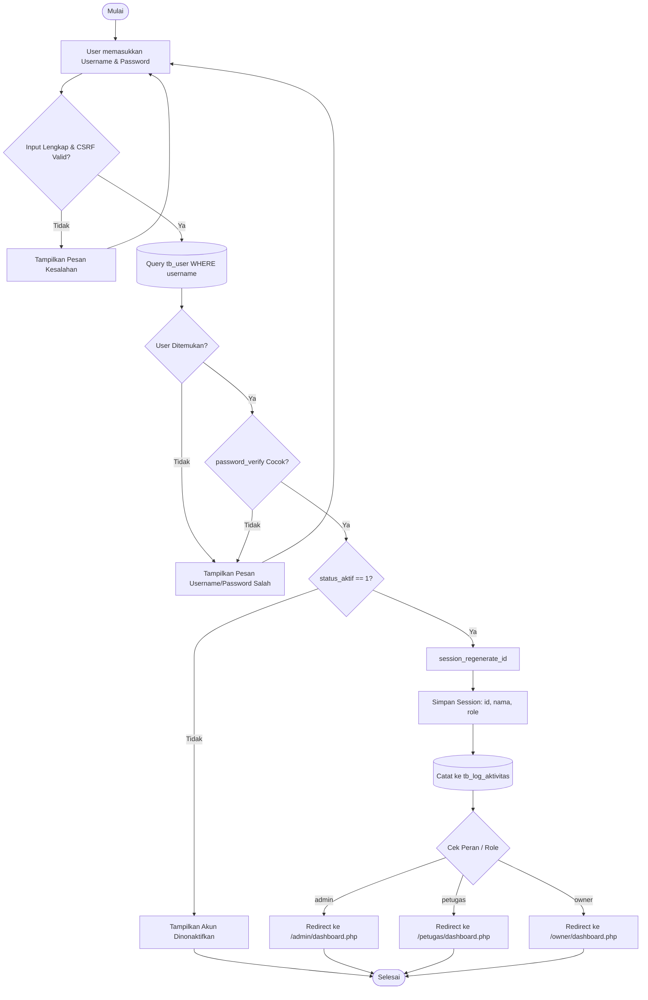
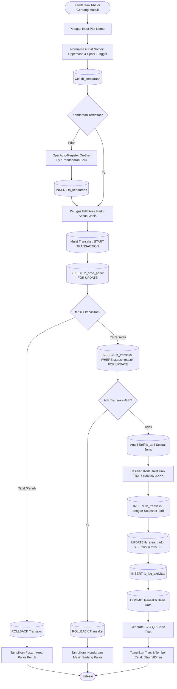
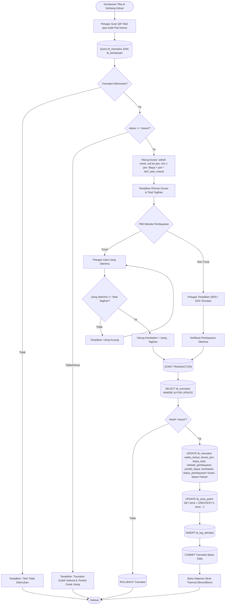
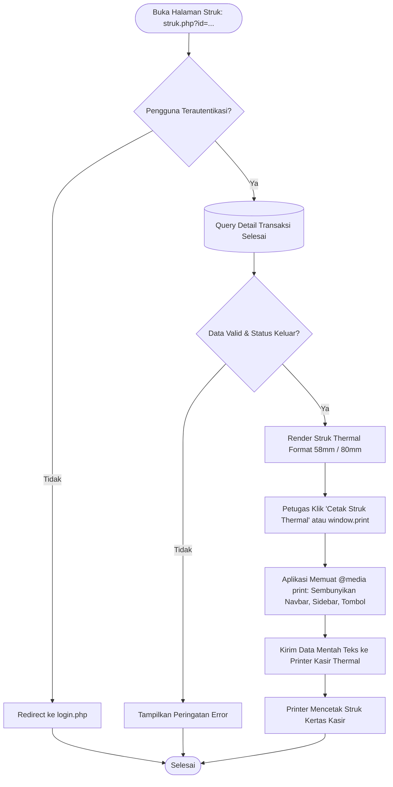
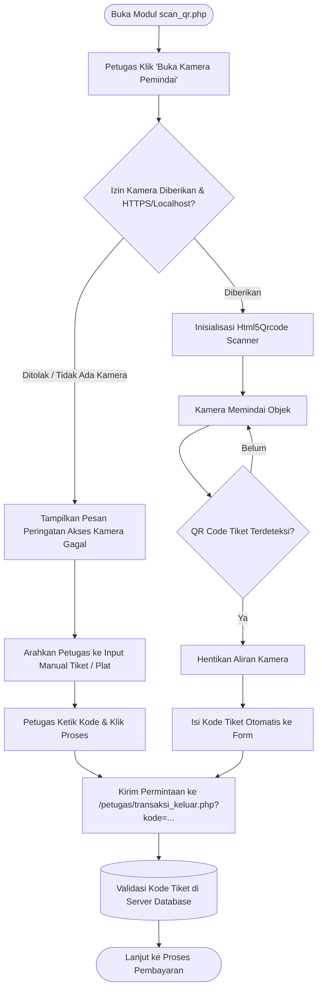
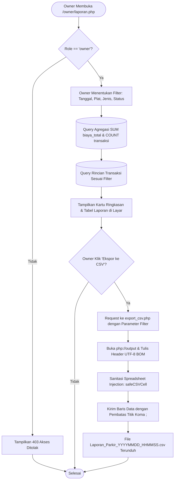

# FLOWCHART SISTEM INFORMASI PARKIR BERBASIS WEB

Berikut adalah kumpulan 6 flowchart alur proses bisnis utama sistem informasi parkir yang digambar menggunakan sintaks Mermaid standar.

---

## 1. Flowchart Login dan Autentikasi Peran

---

## 2. Flowchart Transaksi Parkir Masuk (Dengan Auto-Register & Concurrency Locking)

---

## 3. Flowchart Transaksi Parkir Keluar, Kalkulasi Biaya & Pembayaran

---

## 4. Flowchart Pencetakan Struk Thermal

---

## 5. Flowchart Pemindaian QR Code (Kamera & Alternatif Manual)

---

## 6. Flowchart Rekapitulasi & Ekspor CSV Owner

